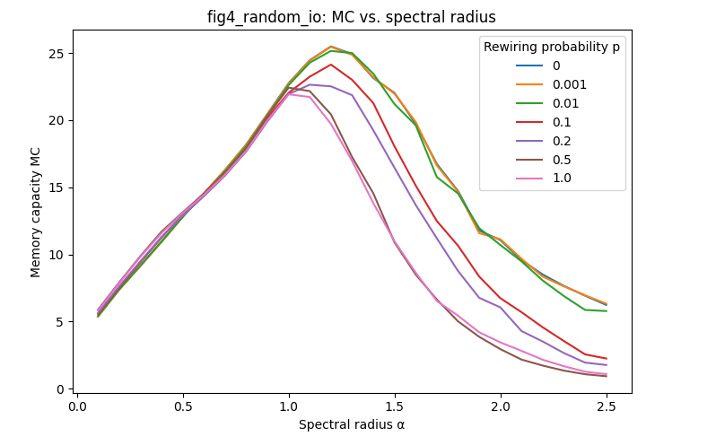
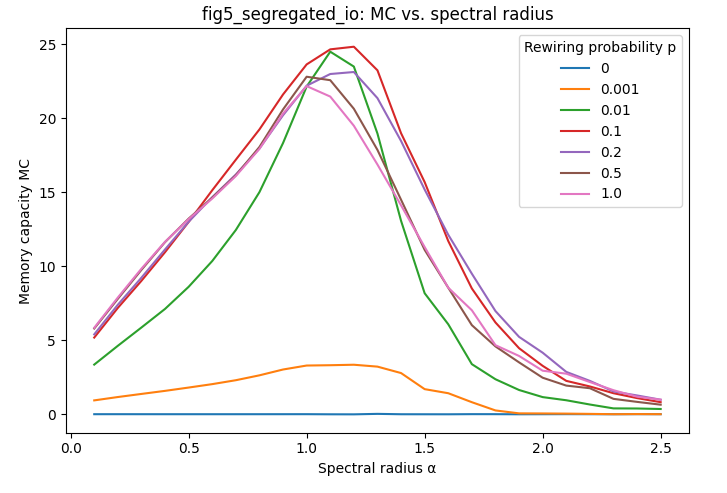
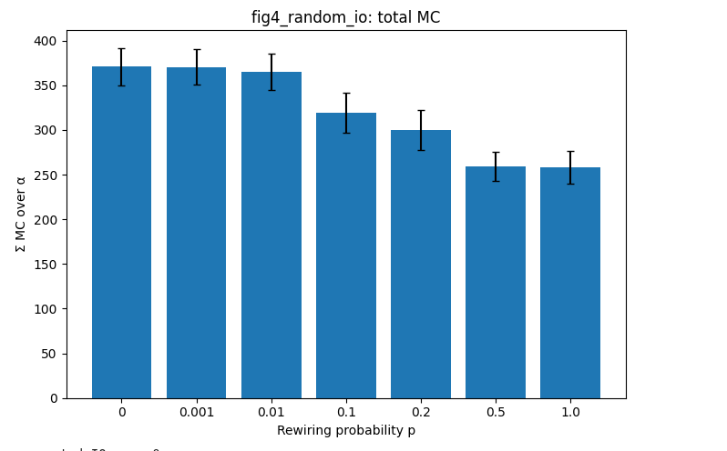
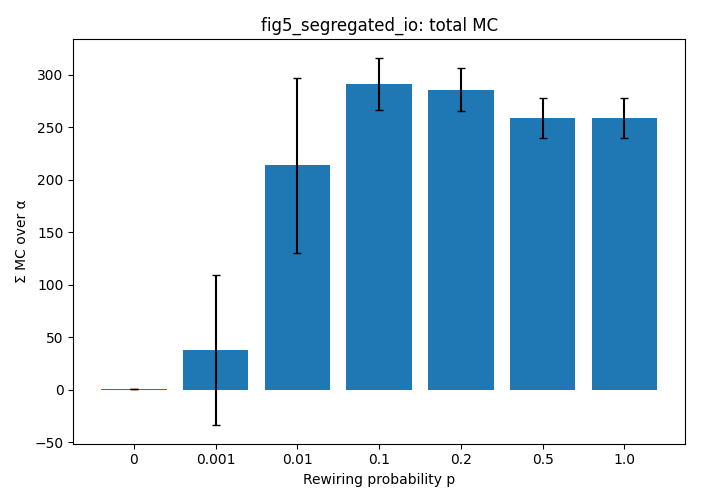

# Small-World Echo State Network: Memory Capacity

A Python reimplementation of the memory capacity experiments from

> Kawai, Y., Park, J., & Asada, M. (2019). A small-world topology enhances the echo state property and signal propagation in reservoir computing. *Neural Networks*, 112, 15-23. https://doi.org/10.1016/j.neunet.2019.01.002

I wrote this while learning about reservoir computing and about how network topology shapes neural dynamics. The paper asks a simple question. If an echo state network (ESN) has a small-world reservoir, does it remember its input better than a regular or a random reservoir, especially when the input and output nodes sit far apart from each other? This repository reproduces the memory capacity part of that study (Figures 4 and 5 of the paper).

## What the code does

The reservoir has 500 nodes and 6 connections per node. It is built with the Watts-Strogatz model, where a ring lattice is rewired with probability `p`. Low `p` gives a regular network, `p` around 0.1 gives a small-world network, and `p = 1` gives a random network.

For every rewiring probability (0, 0.001, 0.01, 0.1, 0.2, 0.5, 1.0) and every spectral radius from 0.1 to 2.5, the script drives the reservoir with a random input series and trains a ridge-regression readout to recall the input from 1 to 40 steps earlier. Memory capacity (MC) is the sum of the squared correlations between the recalled and the true delayed input.

Two settings are compared.

- **Random IO (Fig. 4).** Input and output nodes are chosen at random, without overlap.
- **Segregated IO (Fig. 5).** The 100 input nodes sit on one side of the ring and the 100 output nodes on the opposite side, so the signal has to travel through the reservoir to reach the readout.

## Results

Figures are saved by the script after a run.

| Random IO (Fig. 4) | Segregated IO (Fig. 5) |
|---|---|
|  |  |
|  |  |

The overall pattern follows the paper. When input and output nodes are chosen at random, the regular reservoir keeps a high memory capacity over a wide range of spectral radii, while the random reservoir peaks near a radius of 1 and then drops quickly. When the nodes are segregated, the regular reservoir can no longer pass the signal to the readout, and the small-world reservoir gives the largest total memory capacity.

## Running it

```bash
pip install -r requirements.txt
python sw_esn_memory_capacity.py
```

The full run (7 values of `p`, 25 spectral radii, 20 trials, both settings) takes a while on a laptop. For a quick check, lower `N_TRIALS` and coarsen `ALPHAS` at the top of the script.

## Implementation notes

- The graphs come from NetworkX's `watts_strogatz_graph`, which rewires undirected edges. Each direction of a connection then receives its own random weight, so the weight matrix is directed. The paper rewires directed connections, so the exact path length and clustering values can differ slightly from the published ones. The total number of connections is the same (3000).
- Each result is averaged over 20 trials (the paper uses 100). Every trial draws a new network, new weights, and a new random input series.
- Parameters follow the paper: 100 input nodes, 100 output nodes, weights uniform in [-0.5, 0.5], ridge coefficient 1e-10, 100 washout steps, 2000 training steps and 2000 test steps.
- This repository focuses on the memory capacity task. The paper also covers Mackey-Glass prediction, Lyapunov exponents, and reservoirs built from human cortical connectivity, which would be natural next steps.

## Files

- `sw_esn_memory_capacity.py` runs both experiments and saves the figures.
- `requirements.txt` lists the Python packages.

## Author

Fatemeh Tavakkoli
